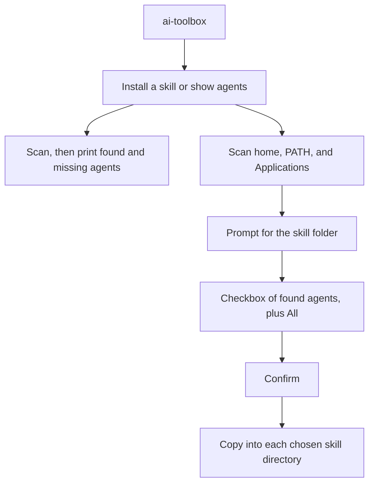

# Phase 1: install local skills per agent

Phase 1 is an interactive Node CLI named `ai-toolbox`. It only installs skills. Plugins, MCP servers, delete, and project-scoped skills stay out of this phase. Each agent lives in one registry so later actions can reuse the same scan.

A skill is a folder already on disk that contains `SKILL.md`. The CLI copies the whole folder, except `.git`, into each chosen agent’s user skills directory. It does not download from git and it does not move the source.

## Scan

Every command that lists or installs scans this machine first, before it asks about a skill or agents. The scan checks known locations only: a config directory in the home folder, a CLI on `PATH`, and an app in `/Applications` or `~/Applications`. It does not walk the whole disk. An agent is available when any one of its signals is found.

The same scan result feeds the agent list and the install checkbox. Agents the scan does not find are listed by `ai-toolbox agents` and omitted from the checkbox. Install never targets them.

- **Cursor** — `~/.cursor`, `cursor`, or `Cursor.app`. Writes `~/.cursor/skills/<name>`. Never write `~/.cursor/skills-cursor`.
- **Claude** — `~/.claude`, `claude`, or `Claude.app`. Writes `~/.claude/skills/<name>`.
- **ChatGPT** — `~/.codex`, `codex`, or `ChatGPT.app`. Writes `~/.codex/skills/<name>`. The ChatGPT app has no separate local skills folder.
- **Gemini** — `~/.gemini`, `gemini`, or `Gemini.app`. Writes `~/.gemini/skills/<name>`.
- **Grok** — `~/.grok`, `grok`, or `Grok.app`. Writes `~/.grok/skills/<name>`.

`~/.agents/skills` is not an install target. Codex, Cursor, and Gemini all read it, so a copy there would not stay with one agent. Cursor also reads `~/.claude/skills` and `~/.codex/skills`. After an install into Claude or ChatGPT, if Cursor was found and was not one of the chosen agents, the CLI prints one line per folder saying that Cursor also reads it and will see that skill. Choosing Cursor, or choosing only other agents, prints no note. The copy is still written only to the directory the user chose.

On the machine this was planned on, the scan finds Cursor, Claude, and ChatGPT. Gemini and Grok are not installed.

## Flow

`ai-toolbox` with no command offers **Install a skill** or **Show agents**, and scans once one is chosen. Show agents prints the scan and stops. `ai-toolbox agents` prints that same list with no menu. `ai-toolbox install` skips the menu and starts at the skill folder.

Install prompts, in order:

1. **Skill folder.** Ask for a path. If it is not a directory or has no `SKILL.md`, say why and ask again.
2. **Agents.** One checkbox. The first row is **All**. The other rows are only agents the scan found. Space toggles a row. **All** installs into every found agent and ignores the other rows. Any other selection installs only into those agents. If nothing is selected, ask again. If the scan found nobody, the command stops with an error before the first prompt.
3. **Confirm.** Show the skill name and the agent names. Declining cancels before any copy.

These flags skip the prompts they already answer, so a full command can run without a terminal. `--agent` is repeatable. `--agent` and `--all` cannot be used together. `--yes` skips confirm. `--force` replaces an existing destination. If a required value is missing and stdin or stdout is not a terminal, exit with an error that names the flag to pass, instead of prompting.

- `ai-toolbox install <skill-dir> --agent cursor --agent claude`
- `ai-toolbox install <skill-dir> --all`

## Install rules

- Read `name` from `SKILL.md` frontmatter. If it is missing, use the folder name. Require a non-empty `description`. The name must be 1–64 characters of lowercase letters, numbers, and hyphens, so one folder is valid for every agent. The destination folder uses that name.
- Create the agent skills directory when it is missing.
- If a chosen destination already exists, copy nothing unless `--force` is set. `--force` replaces that destination only.
- A named agent that is unknown or absent from the scan fails the command before any copy. `--all` means every agent the scan found.
- Check every destination, then copy. If a copy fails part-way, remove the new copies made so far and report which agent failed. A destination replaced with `--force` is not restored, because its old contents are already gone.
- Refuse to install a skill onto itself, with or without `--force`. Installing from `~/.claude/skills/<name>` into Claude would otherwise delete the source before copying it.
- Report progress before each copy so the spinner can show the current agent.

## Presentation

[Commander](https://github.com/tj/commander.js) defines the commands and flags. [`@inquirer/prompts`](https://github.com/SBoudrias/Inquirer.js) runs the menu, path prompt, checkbox, and confirm. [chalk](https://github.com/chalk/chalk) colors output. [ora](https://github.com/sindresorhus/ora) is the install spinner.

Found agents are green, missing agents are dim, and skill paths are cyan. After confirm, one spinner updates per agent, for example `Installing review-pr into Claude...`, then stops with a green line naming the agent and the path. Errors are red and the spinner fails. The spinner starts before the destination checks run, so a conflict shows as a failed spinner followed by the error. Color and the spinner turn off when output is not a terminal (chalk and ora detect this on their own) or when `NO_COLOR` is set. Neither library reads `NO_COLOR`, so `src/colors.ts` and `src/progress.ts` handle it: with `NO_COLOR` set, output is plain lines with no animation. Ctrl+C in a prompt exits quietly with code 130.

## Tech stack and layout

TypeScript on Node 24. Commander, `@inquirer/prompts`, chalk, and ora are all ES-module-only, so the package sets `"type": "module"` and compiles with `NodeNext` module settings. Tests use `node:test` and call the scan and install functions directly, with a temporary home directory. They do not open prompts. Dev dependencies are `typescript` and `@types/node` at major version 24 to match the runtime. Runtime dependencies are `commander`, `@inquirer/prompts`, `chalk`, `ora`, and `yaml`. The `yaml` package parses `SKILL.md` frontmatter, because real skills use folded blocks (`>-`), quoted text, and plain text that a hand-written parser would misread.

Node strips types without checking them and ignores `tsconfig.json`, so these rules apply (from the Node TypeScript docs):

- `npm test` runs `node --test "src/**/*.test.ts"`. `npm run typecheck` runs `tsc --noEmit`. `npm run build` compiles `src/` to `dist/` with `tsconfig.build.json`, which excludes the test files and `src/test-support.ts`.
- Each test file sits next to the module it covers, such as `skill.ts` and `skill.test.ts`.
- `tsconfig.json` sets `module: nodenext`, `rewriteRelativeImportExtensions`, `erasableSyntaxOnly`, and `verbatimModuleSyntax`.
- Relative imports use the `.ts` extension, and the code does not use `enum` or other syntax that cannot be erased.

- `package.json` — bin `ai-toolbox`, scripts `build`, `typecheck`, and `test`
- `src/cli.ts` — wires the real scan, prompts, spinner, colors, and output into the program. It has no test of its own; it is checked by running the built tool.
- `src/program.ts` — Commander commands and flags
- `src/run-cli.ts` — runs the program and turns errors into messages and exit codes
- `src/install-command.ts` — the install flow: choose, confirm, install, report. Prompts, spinner, and output are passed in, so tests use fakes.
- `src/selection.ts` — turns `--agent` and `--all` into install targets
- `src/agent-choices.ts` — the checkbox rows, with **All** first, and the selection they produce
- `src/prompts.ts` — the real `@inquirer/prompts` prompts. A thin wrapper with no test of its own; it is checked by running the built tool.
- `src/progress.ts` — the `ora` spinner, plain when `NO_COLOR` is set
- `src/colors.ts` — chalk, off when `NO_COLOR` is set
- `src/format.ts` — the agent list lines
- `src/agents/registry.ts` — the five agents and their detection signals and skill paths
- `src/agents/scan.ts` — the scan of home, `PATH`, and Applications
- `src/skills/skill.ts` — read and validate `SKILL.md`
- `src/skills/install.ts` — check destinations, copy, and roll back
- `src/**/*.test.ts` — one test file beside each module above that has tests, using a temporary home directory
- `src/test-support.ts` — shared test helpers, excluded from the build

Usage is in `ai-toolbox --help`.
