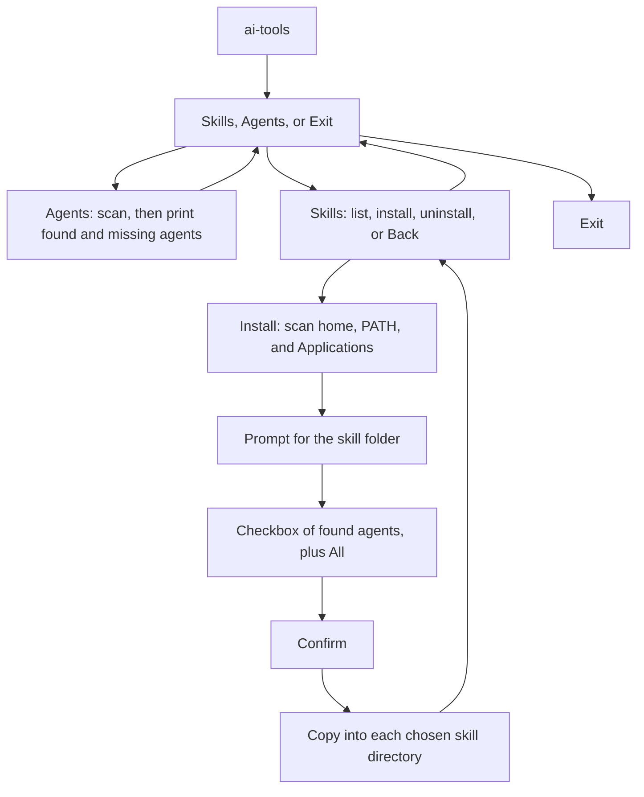

# Phase 1: install and remove local skills per agent

Phase 1 is an interactive Node CLI named `ai-tools`. It installs and removes skills. Plugins, MCP servers, and project-scoped skills stay out of this phase. Each agent lives in one registry so later actions can reuse the same scan.

A skill is a folder already on disk that contains `SKILL.md`. The CLI copies the whole folder, except `.git`, into each chosen agent’s user skills directory. It does not download from git and it does not move the source.

## Scan

Every command that lists, installs or removes scans this machine first, before it asks about a skill or agents. The scan checks known locations only: a config directory in the home folder, a CLI on `PATH`, and an app in `/Applications` or `~/Applications`. It does not walk the whole disk. An agent is available when any one of its signals is found.

The same scan result feeds the agent list and the install checkbox. Agents the scan does not find are listed by `ai-tools agents` and omitted from the checkbox. Install never targets them.

- **Cursor** — `~/.cursor`, `cursor`, or `Cursor.app`. Writes `~/.cursor/skills/<name>`. Never write `~/.cursor/skills-cursor`.
- **Claude** — `~/.claude`, `claude`, or `Claude.app`. Writes `~/.claude/skills/<name>`.
- **ChatGPT** — `~/.codex`, `codex`, or `ChatGPT.app`. Writes `~/.codex/skills/<name>`. The ChatGPT app has no separate local skills folder.
- **Gemini** — `~/.gemini`, `gemini`, or `Gemini.app`. Writes `~/.gemini/skills/<name>`.
- **Grok** — `~/.grok`, `grok`, or `Grok.app`. Writes `~/.grok/skills/<name>`.

`~/.agents/skills` is not an install target. Codex, Cursor, and Gemini all read it, so a copy there would not stay with one agent. Cursor also reads `~/.claude/skills` and `~/.codex/skills`. After an install into Claude or ChatGPT, if Cursor was found and was not one of the chosen agents, the CLI prints one line per folder saying that Cursor also reads it and will see that skill. Choosing Cursor, or choosing only other agents, prints no note. The copy is still written only to the directory the user chose.

On the machine this was planned on, the scan finds Cursor, Claude, and ChatGPT. Gemini and Grok are not installed.

## Flow

`ai-tools` with no command opens a menu with **Skills**, **Agents** and **Exit**. **Skills** opens a second menu with **List skills**, **Install a skill**, **Uninstall a skill** and **Back**. **Agents** prints the agent list. Each action scans when it is chosen. After an action ends, the menu it was chosen from is shown again, so the user stays in **Skills** until they pick **Back**. The user leaves with **Exit** (exit code 0) or Ctrl+C (exit code 130). **Agents** prints the scan, and `ai-tools agents` prints that same list with no menu. **List skills** opens a list of the installed skills that the user moves through, and `ai-tools skills` prints the same skills as plain lines with no menu. `ai-tools install` skips the menu and starts at the skill folder. `ai-tools uninstall` skips the menu and starts at the list of installed skills.

Install prompts, in order:

1. **Skill folder.** Ask for a path. If it is not a directory or has no `SKILL.md`, say why and ask again.
2. **Agents.** One checkbox. The first row is **All**. The other rows are only agents the scan found. Space toggles a row. **All** installs into every found agent and ignores the other rows. Any other selection installs only into those agents. If nothing is selected, ask again. If the scan found nobody, the command stops with an error before the first prompt.
3. **Confirm.** Show the skill name and the agent names. Declining cancels before any copy.

These flags skip the prompts they already answer, so a full command can run without a terminal. `--agent` is repeatable. `--agent` and `--all` cannot be used together. `--yes` skips confirm. `--force` replaces an existing destination. If a required value is missing and stdin or stdout is not a terminal, exit with an error that names the flag to pass, instead of prompting.

- `ai-tools install <skill-dir> --agent cursor --agent claude`
- `ai-tools install <skill-dir> --all`

## Install rules

- Read `name` from `SKILL.md` frontmatter. If it is missing, use the folder name. Require a non-empty `description`. The name must be 1–64 characters of lowercase letters, numbers, and hyphens, so one folder is valid for every agent. The destination folder uses that name.
- Create the agent skills directory when it is missing.
- If a chosen destination already exists, copy nothing unless `--force` is set. `--force` replaces that destination only.
- A named agent that is unknown or absent from the scan fails the command before any copy. `--all` means every agent the scan found.
- Check every destination, then copy. If a copy fails part-way, remove the new copies made so far and report which agent failed. A destination replaced with `--force` is not restored, because its old contents are already gone.
- Refuse to install a skill onto itself, with or without `--force`. Installing from `~/.claude/skills/<name>` into Claude would otherwise delete the source before copying it.
- Report progress before each copy so the spinner can show the current agent.

## Uninstall rules

`ai-tools uninstall` takes no flags. The user picks the skill from a list, so a script cannot name one. If stdin or stdout is not a terminal, it exits with an error and removes nothing. A name argument and the `--agent`, `--all` and `--yes` flags can be added later without changing this flow.

Prompts, in order:

1. **Skill.** One list of every skill found in the skills folders of the agents the scan found, sorted by name. Each row shows which agents have it.
2. **Agents.** One checkbox of only the agents that have that skill, all ticked. If none is selected, the command stops with an error.
3. **Confirm.** Names the skill and the agents and says it cannot be undone. The default answer is No. Declining removes nothing.

- A row is listed only when its folder name is valid (the same 1–64 character rule as install) and the folder contains a `SKILL.md`. Loose files, folders without `SKILL.md`, and folders such as `.system` are not listed. A skills folder that does not exist counts as empty. `~/.cursor/skills-cursor` is never read.
- The list includes skills the user added by hand, not only ones this tool installed. The tool keeps no record of what it installed.
- Before removing anything, check every chosen destination: it must be a folder with a `SKILL.md`. If any check fails, remove nothing and report which agent failed.
- Reject a name that is not valid before touching the disk, so a value such as `..` can never point outside the skills folder.
- Removal is permanent. There is no trash or backup.
- Cursor also reads the Claude and ChatGPT folders, so removing a skill from one of those also removes it for Cursor. Uninstall prints no note about this.
- If no agent is found, or no skills are installed, the command says so and removes nothing. No agent found is an error. No skills installed is a normal result with exit code 0.

## List skills

`ai-tools skills` prints one line per skill, sorted by name: the name padded to the widest name, then the agents that have it in dim text, such as `review-pr  Cursor, Claude`. It uses the same list as uninstall, so the validity rules above apply and skills added by hand are included. Only agents the scan found are read. It asks no questions and works without a terminal. If no agent is found it is an error. If no skills are installed it prints "No skills are installed in the agents that were found." and exits with 0. It prints no description, because that would need `SKILL.md` to be read for every skill.

In the menu, **List skills** shows the same skills as a list with a highlighted row, like the skill list in uninstall. The line under the highlighted row says which agents have it (`Installed in Cursor, Claude`). Enter on a skill prints its details and shows the list again: the skill name, then each agent with the skill's folder. **Back** leaves the list, and so does Esc: the footer reads `↑↓ navigate • ⏎ select • esc back`. Inquirer's list has no Esc key, so `src/escape.ts` listens for it on stdin and cancels the prompt with an `AbortSignal`, which Inquirer supports. Esc works only on this list for now; the menus still use their **Back** and **Exit** rows. A lone Esc takes about half a second to register, because the terminal waits to see whether it starts an arrow-key sequence. It changes nothing on disk. It needs a terminal, as the rest of the menu does. A pager (`less`) was tried first and dropped: a list shorter than the screen never opened it, so nothing could be moved through.

## Presentation

[Commander](https://github.com/tj/commander.js) defines the commands and flags. [`@inquirer/prompts`](https://github.com/SBoudrias/Inquirer.js) runs the menu, path prompt, checkbox, and confirm. [chalk](https://github.com/chalk/chalk) colors output. [ora](https://github.com/sindresorhus/ora) is the spinner for install and uninstall.

Found agents are green, missing agents are dim, and skill paths are cyan. After confirm, one spinner updates per agent, for example `Installing review-pr into Claude...`, then stops with a green line naming the agent and the path. Errors are red and the spinner fails. The spinner starts before the destination checks run, so a conflict shows as a failed spinner followed by the error. Color and the spinner turn off when output is not a terminal (chalk and ora detect this on their own) or when `NO_COLOR` is set. Neither library reads `NO_COLOR`, so `src/colors.ts` and `src/progress.ts` handle it: with `NO_COLOR` set, output is plain lines with no animation. Ctrl+C in a prompt exits quietly with code 130.

## Menu

The menu is a session, so it loops, while the commands are one-shot: each command runs once and exits, so scripts can use it. This is a design choice, not a rule from a published standard. The menu is a tree of entries. An entry is either an action or a group of more entries, and the root shows **Exit** where a group shows **Back**. To add a feature, such as plugins or MCP servers, add an entry to `menuEntries` in `src/cli.ts`; `src/menu.ts` does not change. The loop is in `src/menu.ts`, and every dependency is passed in, so tests use fakes.

- The menu needs a terminal. Without one it exits with an error that points to the commands, and it never draws the menu into a pipe.
- A user error in an action (a skill that already exists, for example) prints in red and returns to the menu it came from. The messages come from `src/user-error.ts`, which `src/run-cli.ts` also uses.
- Any other error ends the program with exit code 1.
- Ctrl+C quits the whole program with code 130, at the menu or in any prompt. It does not go back to the menu.

## Tech stack and layout

TypeScript on Node 24. Commander, `@inquirer/prompts`, chalk, and ora are all ES-module-only, so the package sets `"type": "module"` and compiles with `NodeNext` module settings. Tests use `node:test` and call the scan and install functions directly, with a temporary home directory. They do not open prompts. Dev dependencies are `typescript` and `@types/node` at major version 24 to match the runtime. Runtime dependencies are `commander`, `@inquirer/prompts`, `chalk`, `ora`, and `yaml`. The `yaml` package parses `SKILL.md` frontmatter, because real skills use folded blocks (`>-`), quoted text, and plain text that a hand-written parser would misread.

Node strips types without checking them and ignores `tsconfig.json`, so these rules apply (from the Node TypeScript docs):

- `npm test` runs `node --test "src/**/*.test.ts"`. `npm run typecheck` runs `tsc --noEmit`. `npm run build` compiles `src/` to `dist/` with `tsconfig.build.json`, which excludes the test files and `src/test-support.ts`.
- Each test file sits next to the module it covers, such as `skill.ts` and `skill.test.ts`.
- `tsconfig.json` sets `module: nodenext`, `rewriteRelativeImportExtensions`, `erasableSyntaxOnly`, and `verbatimModuleSyntax`.
- Relative imports use the `.ts` extension, and the code does not use `enum` or other syntax that cannot be erased.

- `package.json` — bin `ai-tools`, scripts `build`, `typecheck`, and `test`
- `src/cli.ts` — wires the real scan, prompts, spinner, colors, and output into the program. It has no test of its own; it is checked by running the built tool.
- `src/program.ts` — Commander commands and flags
- `src/run-cli.ts` — runs the program and turns errors into messages and exit codes
- `src/user-error.ts` — which errors are user errors, and how they are printed. Used by `run-cli.ts` and `menu.ts`.
- `src/menu.ts` — the menu tree and loop: ask, open a group or run an action, show a user error and ask again, until Exit or Back
- `src/install-command.ts` — the install flow: choose, confirm, install, report. Prompts, spinner, and output are passed in, so tests use fakes.
- `src/selection.ts` — turns `--agent` and `--all` into install targets
- `src/agent-choices.ts` — the checkbox rows, with **All** first, and the selection they produce
- `src/escape.ts` — runs a prompt and cancels it when Esc is pressed. The key source is passed in, so tests use a fake.
- `src/prompts.ts` — the real `@inquirer/prompts` prompts. A thin wrapper with no test of its own; it is checked by running the built tool.
- `src/progress.ts` — the `ora` spinner, plain when `NO_COLOR` is set
- `src/colors.ts` — chalk, off when `NO_COLOR` is set
- `src/format.ts` — the agent list lines, the skill list lines and one skill's details
- `src/agents/registry.ts` — the five agents and their detection signals and skill paths
- `src/agents/scan.ts` — the scan of home, `PATH`, and Applications
- `src/skills/skill.ts` — read and validate `SKILL.md`
- `src/skills/install.ts` — check destinations, copy, and roll back
- `src/skills/list.ts` — find the valid skills installed in each agent's skills folder, grouped by name
- `src/skills/uninstall.ts` — check every destination, then remove the skill folders
- `src/list-skills-command.ts` — the `skills` command: scan, list, print. It also holds the scan-and-read step that browsing shares. Output is passed in, so tests use fakes.
- `src/browse-skills-command.ts` — the menu's list skills flow: choose a skill, show its details, ask again until Back. Prompts and output are passed in, so tests use fakes.
- `src/uninstall-command.ts` — the uninstall flow: list, choose, confirm, remove, report. Prompts, spinner, and output are passed in, so tests use fakes.
- `src/**/*.test.ts` — one test file beside each module above that has tests, using a temporary home directory
- `src/test-support.ts` — shared test helpers, excluded from the build

Usage is in `ai-tools --help`.
